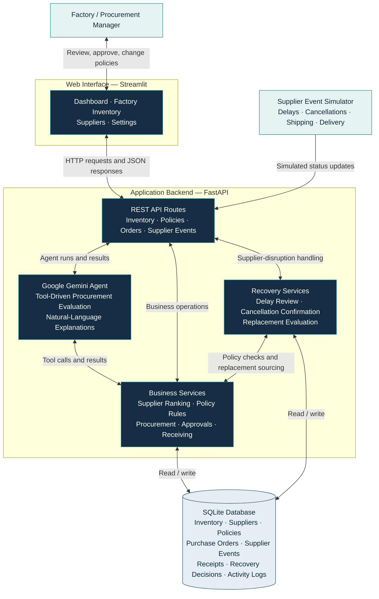

<div align="center">


# ChainPilot

### Autonomous, Policy-Aware Procurement for Manufacturing

**Humane Hackathon · Autonomous Enterprises Challenge**

An AI-powered procurement demo that detects factory component shortages, evaluates suppliers, creates simulated purchase orders, and adapts to delivery disruptions—while enforcing business policies and retaining human oversight.

<!-- Add your demo link here after uploading the video. -->
**[Demo Video](#demo-video)** · **[How It Works](#how-it-works)** · **[Getting Started](#getting-started)**

</div>

---

## The Challenge

Manufacturing procurement often requires manually comparing factory demand with stock, checking competing suppliers, applying purchasing rules, and reacting when orders are delayed or cancelled. These repeated decisions can slow procurement and increase production uncertainty.

**ChainPilot addresses the Humane Hackathon’s Autonomous Enterprises challenge** by automating the evaluation and execution of *simulated* procurement decisions under clear business constraints.

## The Solution

ChainPilot brings together inventory information, supplier availability, business policies, and purchase-order status in one workflow:

1. **Detect** — Identify demand not covered by physical warehouse stock or active outstanding orders.
2. **Decide** — Examine eligible supplier availability, unit prices, delivery times, reliability, and company priorities.
3. **Act** — Reserve supplier quantities, create simulated purchase orders, and request manager approval when required.
4. **Adapt** — Review delayed orders under the current policy; keep them or request cancellation and evaluate faster replacements when justified.
5. **Explain** — Display agent evaluations and saved recovery reasons in the dashboard and activity history.

### Business Controls

- **Purchasing policies:** Delivery speed, purchase cost, supplier reliability, maximum delivery days, and outstanding budget.
- **Human oversight:** Manager approvals for purchases requiring authorization.
- **Supplier disruptions:** Simulated delay, shipment, delivery, cancellation, and partial-fulfillment events.
- **Inventory accuracy:** Outstanding orders and physically received warehouse stock are tracked separately.
- **Audit trail:** Purchase orders, supplier events, and policy-based recovery decisions remain visible in the application.

> **Demo scope:** ChainPilot uses seeded/simulated factory and supplier data. Purchase orders represent commitments in a local demo; there are **no real supplier purchases, payments, refunds, or production integrations**.

## How It Works

ChainPilot follows a **Detect → Decide → Act → Adapt → Explain** workflow. The Gemini agent inspects procurement needs and requests tools, while the backend enforces business rules and records all resulting changes.

## System Architecture

The following diagram shows the **implemented demo architecture**, including the manager-facing interface, supplier-event simulator, AI agent, business services, and persistent data storage. GitHub renders this Mermaid diagram directly in the README.



**Architecture at a glance:**

| Layer | Technology | Responsibility |
|---|---|---|
| Frontend | **Streamlit** | Displays inventory, orders, supplier updates, policy controls, and explanations. |
| API | **FastAPI** | Handles requests, manager approvals, inventory changes, and simulated supplier-event webhooks. |
| AI evaluation | **Google Gemini** | Uses tools to inspect shortages and suppliers, initiate evaluations, and explain results. |
| Business logic | **Python services** | Enforces purchasing budgets, lead-time constraints, supplier eligibility, reservations, and approval rules. |
| Recovery | **Python recovery services** | Reviews delayed orders, requests/records cancellations, and evaluates eligible replacements. |
| Persistence | **SQLite** | Stores inventory, supplier offers, policies, purchase orders, receipts, events, and activity history. |

> **Important:** This is a **hybrid AI-and-rules architecture**. Gemini does not directly bypass authorization or update warehouse stock on its own. The Python backend enforces constraints; the supplier integration and purchases are simulated for the demo.

**Technology stack:** Python · Streamlit · FastAPI · Google Gemini · SQLite.

## Example: A Factory Shortage

A factory needs **500 batteries**, has **200 in its warehouse**, and has **no batteries already on order**.

**Uncovered demand** = `max(0, required - warehouse stock - active outstanding orders)` = **300 batteries**.

Under a policy and supplier state where these allocations are eligible, ChainPilot can split the sourcing plan:

| Supplier | Quantity | Unit price | Simulated commitment |
|---|---:|---:|---:|
| BatteryDirect | 200 | 20 SAR | 4,000 SAR |
| PowerWorks | 100 | 25 SAR | 2,500 SAR |
| **Total** | **300** | | **6,500 SAR** |

The actual selection depends on the current policy, supplier stock, and outstanding commitments. Approval may be required; orders **do not add physical warehouse stock until receipt**.

## Example: Responding to a Delay

If a supplier reports that an unshipped order will arrive later than expected, ChainPilot records the event and evaluates alternatives against the policy:

- **Budget First:** May retain the delayed order when a switch is not justified by cost and constraints.
- **Production First:** May request cancellation when a faster, approved, affordable replacement can cover the remaining quantity.
- **Cancellation safety:** Supplier stock and outstanding commitments are released only after cancellation is confirmed. The demo can simulate this confirmation automatically when enabled.

Each recovery decision includes a reason that can be reviewed in the application. A replacement is not guaranteed if eligible supply or budget is insufficient.

## Interface

ChainPilot provides four Streamlit pages:

| Page | Purpose |
|---|---|
| **Dashboard** | Inventory coverage, procurement evaluation, recovery explanations, approvals, receipts, and purchase history |
| **Factory Inventory** | Warehouse stock, production demand, and resettable demo scenarios |
| **Suppliers** | Supplier availability, reserved quantities, outstanding orders, and simulated status updates |
| **Settings** | Supplier-ranking priorities, outstanding budget, delivery limits, and approval threshold |

<!-- Optionally add your screenshots later:


-->

## Getting Started

### Prerequisites

- Python 3.10 or newer
- A Google Gemini API key

### 1. Clone and install

```bash
git clone https://github.com/WassalAlotaibi/ChainPilot.git
cd YOUR_REPOSITORY
python -m venv .venv
```

Activate the virtual environment:

```powershell
# Windows PowerShell
.venv\Scripts\Activate.ps1
```

```bash
# macOS / Linux
source .venv/bin/activate
```

Install the dependencies:

```bash
pip install -r requirements.txt
```

### 2. Configure the environment

Copy `.env.example` to `.env`, then supply **your own** Gemini API key and a random supplier webhook secret. Keep the `.env` file private.

```dotenv
GEMINI_API_KEY=your_gemini_api_key
GEMINI_MODEL=gemini-3.5-flash-lite
SUPPLIER_WEBHOOK_SECRET=use_a_long_random_secret
ENABLE_DEMO_CONTROLS=true
AUTO_AGENT_ON_EVENTS=true
AUTO_AGENT_ON_INVENTORY=false
DEMO_AUTO_CONFIRM_CANCELLATION=true
SUPPLIER_RESTOCK_ON_COMPLETE=300
```

Model access and available model names depend on your Gemini account. If needed, replace `GEMINI_MODEL` with a supported model configured for your project.

### 3. Start the backend

From the repository root:

```bash
python -m uvicorn backend.main:app --reload
```

API documentation: **http://127.0.0.1:8000/docs**

### 4. Start the frontend

Open another terminal in the same project folder:

```bash
python -m streamlit run frontend/app.py
```

Web interface: **http://localhost:8501**

> **First-time Streamlit setup:** When starting the frontend, Streamlit may ask you to enter an email address for onboarding updates. **An email is not required to run ChainPilot.** Leave the field empty and press **Enter** to skip this prompt. If the prompt has a **Skip** or close option, you can use that instead. Then open the web interface at the address above.

### Suggested Demo Flow

1. Open **Factory Inventory**, load the **300-battery** demo scenario.
2. Set a purchasing strategy in **Settings**.
3. Use **Run ChainPilot** on the **Dashboard** and review the simulated purchasing result.
4. Approve orders that require manager authorization.
5. Use **Suppliers** to report a delay on an active order.
6. Review the saved recovery reason. Optionally change the policy and observe the next reevaluation.
7. Simulate shipping and delivery, then verify the separate warehouse-stock and outstanding-order values.

**Note:** Loading demo scenarios and resetting the factory can clear simulated transaction history. Back up your local database if you need to preserve it.

## Demo Video

**Demo video:** Add the YouTube, Google Drive, or GitHub-hosted video link here after uploading.

**Presentation:** Add your Humane Hackathon pitch deck or screenshots here if you want judges to review them.

## What's Next?

- **Real-world integrations:** Replace simulated inventory and supplier messages with live enterprise and supplier data.
- **Improved interface:** Add stronger reporting, responsive layouts, and actionable notifications.
- **Security and authorization:** Implement user authentication, role-based permissions, and verified supplier access.
- **Predictive intelligence:** Forecast future component demand and supplier delivery risk.

**Long-term vision:** Grow ChainPilot from a demo into a secure, scalable, autonomous procurement platform supporting real manufacturing operations.

## Security and Limitations

- This is a **local hackathon demonstration**, not a production purchasing application.
- Do not commit `.env`, database files, API keys, tokens, or real company data.
- Keep demo-only controls disabled in a real deployment until proper access controls are implemented.
- If a secret has ever been committed to Git history, **rotate that secret**; adding it to `.gitignore` is not sufficient.
- No claims of measured cost savings, production deployment, or third-party supplier integration are made here.

---

<div align="center">

**ChainPilot — Detect · Decide · Act · Adapt**

*Created independently for the Humane Hackathon — Autonomous Enterprises Challenge 3.*

</div>
